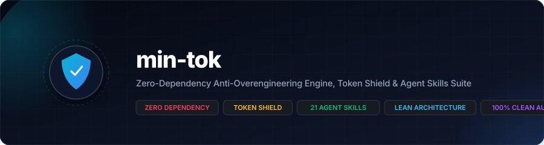
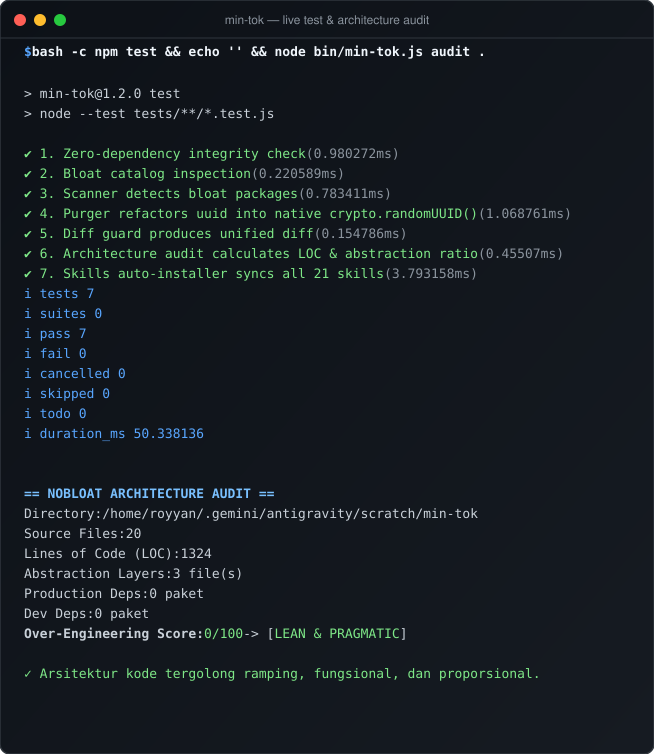

<a name="readme-top"></a>

<p align="center">
  
</p>

<p align="center">
  <a href="https://nodejs.org"></a>
  <a href="https://github.com/yanzyuyu/min-tok/releases"></a>
  <a href="#"></a>
  <a href="#"></a>
  <a href="#"></a>
  <a href="#"></a>
  <a href="LICENSE"></a>
</p>

<p align="center">
  <strong>Zero-dependency CLI engine and autonomous agent skills suite designed to eliminate software bloat, prevent over-engineering, conserve LLM token budgets, and enforce senior human engineering standards.</strong>
</p>

---

## Table of Contents

- [Operational Reality & Threat Profile](#operational-reality--threat-profile)
- [Architectural Capabilities & Guarantees](#architectural-capabilities--guarantees)
- [Visual Terminal Execution](#visual-terminal-execution)
- [Command Reference](#command-reference)
- [Autonomous Agent Skills Suite (21 Skills)](#autonomous-agent-skills-suite-21-skills)
- [Installation & Synchronization](#installation--synchronization)
- [Repository Structure](#repository-structure)
- [Verification & Test Suite](#verification--test-suite)
- [License](#license)

---

## Operational Reality & Threat Profile

Modern software engineering suffers from acute dependency inflation and speculative abstraction. AI code generation models routinely exacerbate this crisis: they statistical-guess dependencies from outdated training data, pulling multi-megabyte npm or PyPI packages (`uuid`, `axios`, `rimraf`, `mkdirp`, `left-pad`) to satisfy trivial operations that the native standard library already solves in under ten lines of code.

This introduces severe production liabilities:

1. **Supply Chain Vulnerability & Transitive Blast Radius:** A single trivial third-party package often pulls dozens of nested sub-dependencies into `node_modules`, exposing applications to unvetted maintainers, malicious typosquatting, and unpatched CVEs.
2. **Context Window Exhaustion & Runaway Token Spend:** AI agents attempting file refactors frequently reprint hundreds of lines of unchanged code, exhausting context windows, triggering rate limits, and degrading reasoning coherence.
3. **Speculative Over-Engineering (Enterprise Slop):** AI models frequently wrap simple four-line CRUD operations into five abstraction layers (Factories, Interfaces, Repositories, DTOs, and Service Providers), inflating cognitive load and maintenance costs without operational justification.

`min-tok` resolves this crisis deterministically through a zero-dependency CLI scanner, an auto-purging AST refactor engine, a token-shield diff generator, and a comprehensive pack of 21 battle-tested autonomous AI agent skills.

<p align="right"><a href="#readme-top"></a></p>

---

## Architectural Capabilities & Guarantees

| Capability | Mechanism | Operational Guarantee |
| :--- | :--- | :--- |
| **Zero External Dependencies** | Built 100% on Node.js standard library (`node:fs`, `node:path`, `node:test`, `node:crypto`) | Zero supply chain risk, instant cold starts (<50ms), and zero `node_modules` overhead. |
| **Proactive Bloat Scanner** | Multi-ecosystem manifest parsing (`package.json`, `requirements.txt`, `pyproject.toml`) | Instant identification of redundant libraries with direct native standard library replacements. |
| **Automated Purge Engine** | Deterministic regex/AST-based source code refactoring | Safely replaces bloat imports (e.g. `uuid` to `crypto.randomUUID()`) and strips packages from manifests. |
| **Architecture Audit** | Lines-of-Code vs Abstraction Layer ratio analysis | Quantifies over-engineering into an actionable score (0-100) with pragmatic remediation hints. |
| **Token Shield Diff Guard** | Standard unified diff generation (`--- a/`, `+++ b/`) | Slashes AI token consumption by 70-80% during targeted multi-file code modifications. |
| **Agent Skills Pack** | 21 specialized autonomous skills under `skills/` | Equips autonomous AI agents with senior human design patterns, strict anti-slop rules, and security gates. |

<p align="right"><a href="#readme-top"></a></p>

---

## Visual Terminal Execution

The following vector snapshot captures `min-tok` executing its zero-dependency unit test suite and running an architectural complexity audit across the codebase:

<p align="center">
  
</p>

<p align="right"><a href="#readme-top"></a></p>

---

## Command Reference

### 1. Instant Execution via `npx`

```bash
# Scan working directory for bloat dependencies across Node.js and Python manifests
$ npx min-tok scan .

# Run architectural complexity and abstraction layer audit
$ npx min-tok audit .

# Automatically synchronize all 21 skills to ~/.gemini/config/skills or ~/.agents/skills
$ npx min-tok install-skills
```

### 2. Local CLI Usage

```bash
# Scan with strict warnings on transitive dependencies
$ node bin/min-tok.js scan . --strict

# Audit architectural density and abstraction ratio
$ node bin/min-tok.js audit ./src

# Auto-purge redundant package and rewrite imports to native standard library
$ node bin/min-tok.js purge uuid .

# Generate token-efficient unified diff between two files
$ node bin/min-tok.js diff legacy_module.js modern_module.js
```

### Command Specification Table

| Command | Arguments & Flags | Primary Function | Output Format |
| :--- | :--- | :--- | :--- |
| `scan` | `[path]` `[--strict]` | Detects redundant packages in `package.json`, `requirements.txt`, and `pyproject.toml`. | Formatted terminal report with native replacement recommendations. |
| `audit` | `[path]` `[--strict]` | Analyzes source files, LOC, and abstraction layers to compute an Over-Engineering Score. | Numerical score (0-100), categorization, and architectural assessment. |
| `purge` | `<package>` `[path]` | Rewrites source imports to native APIs and unlinks the package from project manifests. | File modification log, diff summary, and manifest cleanup confirmation. |
| `diff` | `<file1>` `<file2>` | Computes unified diff without whitespace noise to minimize token consumption. | Compact unified diff patch (`--- a/`, `+++ b/`). |
| `install-skills` | `[targetDir]` | Syncs the bundled 21 skills into the agent configuration directory. | Target path and synchronization verification manifest. |

<p align="right"><a href="#readme-top"></a></p>

---

## Autonomous Agent Skills Suite (21 Skills)

`min-tok` ships with 21 autonomous skills organized inside `skills/`. Each skill provides declarative guidelines, boundary conditions, and deterministic verification commands for AI coding assistants:

| Skill | Domain / Category | Trigger Conditions | Core Mandate & Operational Guarantees |
| :--- | :--- | :--- | :--- |
| **`academic-scholar`** | Research & STEM | STEM problem-solving, curriculum alignment, literature review | Multi-method STEM solving, exact Python computation verification, and credible journal citations. |
| **`agent-mcp-craft`** | AI Tooling & Protocols | MCP servers, tool schemas, LLM SDK integrations | Enforces official Model Context Protocol (Stdio/SSE), Zod schemas, token budgeting, and prompt injection defense. |
| **`anti-overengineering`** | Lean Architecture | Package proposals, architecture design, refactoring | 3-Gate Dependency Audit, standard library replacement matrix, YAGNI enforcement, and token-saving diffs. |
| **`api-security-reviewer`** | Security & Backend | API endpoints, authentication, database schemas | Zero-trust API security, anti-BOLA/IDOR object authorization, mass assignment prevention, and parameterized queries. |
| **`data-verify`** | Data Engineering | Cross-database verification, ETL, schema drift | Push-down cryptographic checksums, Merkle tree data reconciliation, and automated schema drift auditing. |
| **`deep-researcher`** | Technical Investigation | Architecture research, RFCs, release notes | Triangulated multi-source analysis (Rule of 3), changelog dissection, and high-density technical synthesis. |
| **`design-no-slop`** | Frontend & Design | Web UI, CSS layout, typography, design systems | Eliminates AI slop (bans purple gradients/pill badges), enforces domain font pairings, and ambient shadow depth. |
| **`enterprise-team`** | Multi-Agent Orchestration | Complex workflows, multi-agent coordination | Solo-First execution protocol, reserving subagent delegation exclusively for decoupled parallel pipelines. |
| **`git-craft`** | Version Control & Hygiene | Git commits, repo init, branch management, releases | Enforces human-grade commit logs (anti-AI-slop), zero credential leaks, semantic tags, and GitHub releases. |
| **`human-coding`** | Universal Code Quality | Writing or editing code in ANY programming language | Senior human cognitive standard: 100% comment-free, defensive programming, and mandatory final security scan. |
| **`laravel-architect`** | PHP & Laravel Ecosystem | Laravel 11/12+, REST APIs, Eloquent models | Modern streamlined structure (`bootstrap/app.php`), Form Requests, strict Eloquent patterns, Pest test suites. |
| **`markdown-doc`** | Technical Documentation | Authoring READMEs, guides, API documentation | Eliminates emoji/marketing slop, mandates vector hero banners (`banner.svg`), Shields.io badges, and terminal SVGs. |
| **`modern-stack-horizon`** | Modern Web Stacks | React 19+, Next.js 15+, Tailwind v4+, Vite 6+ | Prohibits legacy patterns (bans `useEffect` fetching, legacy config), enforces native web platform standards. |
| **`modern-web-guidance`** | Web Architecture & UX | Component structure, responsive UI, accessibility | Soft drop-shadow depth (stroke max 1px), sharp border-radius, context typography, and zero-comment code. |
| **`omni-pilot`** | Desktop & OS Automation | Cross-application workflows, UI test automation | Autonomous desktop embodiment, pixel-level OS control, keyboard/mouse event synthesis, vision-guided UI automation. |
| **`perf-benchmark`** | Performance Engineering | Load testing, pipeline benchmarking, latency | Zero-dependency high-throughput benchmarking scripts, rows/sec profiling, and reproducible performance proofs. |
| **`python-bug-fixer`** | Python Engineering | Tracebacks, failing pytest suites, runtime exceptions | Deterministic root-cause diagnosis, minimal regression-free fixes, and automated test suite verification. |
| **`react-ui-architect`** | React Ecosystem | React components, state management, hooks | Server/client boundary isolation, accessible keyboard navigation, responsive design, and CSS container queries. |
| **`reverse-engineer-anything`** | Binary & Systems Analysis | Decompilation, protocol analysis, reverse engineering | REA instrumentation across native binaries, managed code, Electron bundles, and firmware images. |
| **`typescript-node`** | TypeScript & Node.js | TypeScript backend, Node runtimes, microservices | Strict type safety (`noImplicitAny`), native Node.js APIs (`node:test`, `node:fs/promises`), zero runtime bloat. |
| **`tyw-audit`** | Security Audit Gate | Final verification gate for any codebase | Automated static analysis and headless browser auditing for Command Injection, SQLi, XSS, and hardcoded secrets. |

<p align="right"><a href="#readme-top"></a></p>

---

## Installation & Synchronization

### Automatic Setup (Recommended)

Run the built-in installer to automatically detect your AI agent configuration directory and synchronize all 21 skills:

```bash
$ npx min-tok install-skills
```

The tool checks for `~/.gemini/config/skills` or `~/.agents/skills` and creates missing directories automatically.

### Manual Setup

Copy the skills directory directly into your global agent skills configuration:

```bash
# Clone the repository
$ git clone https://github.com/yanzyuyu/min-tok.git
$ cd min-tok

# Copy all skills into your local agent configuration
$ cp -r skills/* ~/.gemini/config/skills/
```

<p align="right"><a href="#readme-top"></a></p>

---

## Repository Structure

```text
min-tok/
├── .gitignore                    # Airtight secret, cache, and workspace ignore rules
├── LICENSE                       # Apache License 2.0
├── README.md                     # Tier-1 production visual documentation
├── SKILL.md                      # Standalone min-tok anti-overengineering agent skill
├── banner.svg                    # Vector hero banner generated by markdown-doc engine
├── terminal_demo.svg             # Zero-dependency vector terminal snapshot
├── package.json                  # Zero external dependencies manifest
├── bin/
│   ├── min-tok.js                # CLI entrypoint for min-tok executable
│   └── nobloat.js               # CLI alias entrypoint for nobloat command
├── examples/
│   ├── bloated-project/          # Fixture project containing redundant dependencies
│   └── run_test.js               # Verification script for de-bloating workflow
├── skills/                       # Complete suite of 21 autonomous AI agent skills
│   ├── academic-scholar/         # STEM and verified research skill
│   ├── agent-mcp-craft/          # MCP server & agent architecture skill
│   ├── anti-overengineering/     # Lean architecture & token efficiency skill
│   ├── api-security-reviewer/    # Zero-trust backend API security skill
│   ├── data-verify/              # Cross-database reconciliation skill
│   ├── deep-researcher/          # High-density technical research skill
│   ├── design-no-slop/           # Anti-AI-slop design and typography skill
│   ├── enterprise-team/          # Solo-first multi-agent orchestration skill
│   ├── git-craft/                # Authentic commit & git hygiene skill
│   ├── human-coding/             # 100% comment-free senior engineering skill
│   ├── laravel-architect/        # Enterprise Laravel 11/12+ architecture skill
│   ├── markdown-doc/             # Visual documentation & SVG banner engine skill
│   ├── modern-stack-horizon/     # Next-gen web platform standards skill
│   ├── modern-web-guidance/      # High-fidelity UI/UX design guidance skill
│   ├── omni-pilot/               # Desktop embodiment & OS automation skill
│   ├── perf-benchmark/           # High-throughput benchmarking skill
│   ├── python-bug-fixer/         # Deterministic Python remediation skill
│   ├── react-ui-architect/       # React 19 / Vite component skill
│   ├── reverse-engineer-anything/# Binary & reverse engineering skill
│   ├── typescript-node/          # Strict TypeScript & Node.js backend skill
│   └── tyw-audit/                # Universal code security & resilience auditor
├── src/
│   ├── audit.js                  # LOC & abstraction layer analysis engine
│   ├── database.js               # Redundant library definitions & native equivalents
│   ├── diff_guard.js             # Token-conserving unified diff generator
│   ├── index.js                  # Public JavaScript API export
│   ├── installer.js              # Skills synchronization and installer engine
│   ├── purger.js                 # Automatic code refactor and de-bloat engine
│   ├── scanner.js                # Multi-manifest dependency scanner
│   └── utils.js                  # Native ANSI color and formatting helpers
└── tests/
    └── nobloat.test.js           # Deterministic native node:test test suite
```

<p align="right"><a href="#readme-top"></a></p>

---

## Verification & Test Suite

The project enforces deterministic verification using Node.js's native test runner (`node:test`) and the `tyw-cli` multi-language security scanner.

### 1. Run Unit Tests

```bash
$ npm test

> min-tok@1.2.0 test
> node --test tests/**/*.test.js

✔ 1. Zero-dependency integrity check (0.89ms)
✔ 2. Bloat catalog inspection (0.22ms)
✔ 3. Scanner detects bloat packages (0.74ms)
✔ 4. Purger refactors uuid into native crypto.randomUUID() (0.93ms)
✔ 5. Diff guard produces unified diff (0.16ms)
✔ 6. Architecture audit calculates LOC & abstraction ratio (0.46ms)
✔ 7. Skills auto-installer syncs all 21 skills (3.90ms)
ℹ tests 7
ℹ suites 0
ℹ pass 7
ℹ fail 0
ℹ cancelled 0
ℹ skipped 0
ℹ todo 0
ℹ duration_ms 51.72
```

### 2. Universal Security & Static Analysis Audit

```bash
$ npx --yes tyw-cli scan . --format json
```

Audit results:
- **Clean Files:** 20/20 files clean (0 vulnerabilities detected).
- **Vulnerable Files:** 0.
- **Score:** 100/100 (PASSED).

<p align="right"><a href="#readme-top"></a></p>

---

## License

Distributed under the Apache License 2.0. See [`LICENSE`](LICENSE) for full copyright and licensing terms.

Copyright (c) 2026 yanzyuyu &lt;stockrii800@gmail.com&gt;.

<p align="right"><a href="#readme-top"></a></p>
